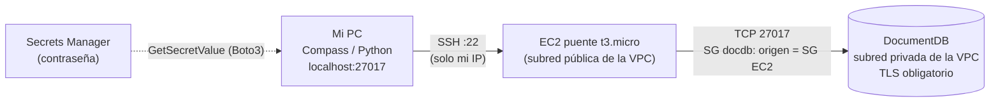

# Punto 3 – Amazon DocumentDB

## 1. DocumentDB vs MongoDB (≥3 diferencias que afectan a una aplicación existente)

DocumentDB es una base compatible con la **API de MongoDB** (emula el protocolo), no MongoDB en sí.

1. **Compatibilidad parcial de API/operadores.** No implementa todas las funciones (algunas etapas de agregación, ciertos operadores y comandos); hay que revisar la [lista de funcionalidades soportadas](https://docs.aws.amazon.com/documentdb/latest/developerguide/mongo-apis.html) antes de migrar.
2. **Retryable writes no soportados** → hay que usar `retryWrites=false` en el driver (si no, las escrituras fallan). MongoDB sí los soporta.
3. **Solo dentro de una VPC y TLS por defecto.** No hay endpoint público ni IP pública: se accede desde la VPC (EC2, VPN, túnel SSH). MongoDB (Atlas o propio) se expone con IP/allowlist.
4. **Arquitectura distinta:** almacenamiento compartido autoescalable (hasta 128 TiB) con un primario y hasta 15 réplicas de lectura; en MongoDB la replicación es por *replica sets* con nodos que guardan copia propia.
5. **Licencia/versión:** se ofrece como servicio gestionado propietario compatible con versiones concretas (p. ej. 4.0, 5.0, 8.0) y no con todo lo nuevo de MongoDB (drivers/features recientes pueden no estar).
6. **Herramientas:** Compass funciona, pero algunas pestañas (p. ej. *Performance*, *Schema*) pueden fallar o mostrar menos información.

## 2. Despliegue de bajo costo y comparación provisionada vs Serverless

Terraform en [terraform/](terraform) con `mode = provisioned` (clase mínima `db.t3.medium`, 1 instancia) o `mode = serverless` (`db.serverless`, 0,5–1 DCU). Contraseña administrada por Secrets Manager (`manage_master_user_password`).

| (us-east-1) | Provisionada `db.t3.medium` | Serverless 0,5 DCU (mínimo) |
|---|---|---|
| Cómputo | ≈ 0,078 US$/h (referencia, confirmar en la calculadora) | 0,0822 US$/DCU-h × 0,5 = **≈ 0,041 US$/h** |
| Almacenamiento | 0,10 US$/GB-mes | 0,10 US$/GB-mes |
| I/O | 0,20 US$/millón | 0,20 US$/millón |
| Backup (1 día, hasta el tamaño del cluster) | incluido | incluido |

**Punto de equilibrio:** 0,078 / 0,0822 ≈ **0,95 DCU** promedio. Mientras la carga media esté por debajo de ~1 DCU, Serverless cuesta menos; la provisionada solo gana con carga alta y sostenida (>~1 DCU promedio constante), y además se paga aunque esté ociosa.

**Conclusión:** para esta práctica (unas horas, carga mínima, 0,5 DCU casi todo el tiempo) **Serverless es ≈ 47 % más barato** (0,041 vs 0,078 US$/h). Se desplegó Serverless con `engine_version = "5.0.0"` (Serverless exige motor 5.0+).

## 3. Conexión: VPC + EC2 + túnel SSH + TLS



Pasos realizados:
1. **Grupo de seguridad de la EC2:** entrada TCP 22 solo desde *mi IP* (`/32`).
2. **Grupo de seguridad de DocumentDB:** entrada TCP 27017 con **origen = SG de la EC2** (no una IP).
3. **EC2** en la misma VPC con llave SSH (par generado local: `ssh-keygen -t ed25519 -f ~/.ssh/taller-docdb`; solo se sube la `.pub`).
4. **Certificado TLS:** se descarga `global-bundle.pem` (`scripts/tunel.sh` lo hace) y se usa como `tlsCAFile`.
5. **Túnel:** `./scripts/tunel.sh <IP_EC2> <ENDPOINT_DOCDB>` → `ssh -N -L 27017:<endpoint>:27017 ec2-user@<IP_EC2>`.
6. **Contraseña:** `aws secretsmanager get-secret-value --secret-id <ARN> --query SecretString --output text` (solo para pegarla en Compass; no se captura en pantalla).

**MongoDB Compass** – *New Connection* → *Advanced Connection Options* (con el túnel abierto):

| Pestaña | Valor |
|---|---|
| General | Connection String Scheme `mongodb://`; marcar **Direct Connection**; Host `localhost:27017` |
| Authentication | *Username/Password*: usuario del secreto (`docdbadmin`), contraseña del secreto, **Authentication Database `admin`**, mecanismo por defecto |
| TLS/SSL | **On**; *CA Certificate* = `global-bundle.pem`; activar **Allow invalid hostnames** (el certificado es del endpoint de AWS, no de `localhost`) |
| Advanced | *Read Preference* `Primary`; en URI `retryWrites=false` |

Equivale al URI:
```
mongodb://<usuario>@localhost:27017/?authSource=admin&tls=true&tlsCAFile=<ruta>/global-bundle.pem&tlsAllowInvalidHostnames=true&directConnection=true&retryWrites=false
```
(La contraseña se escribe en el campo de Compass, no se guarda en el repositorio.)

## 4. Ejecución

```bash
ssh-keygen -t ed25519 -f ~/.ssh/taller-docdb -N ""
cd terraform
terraform init
terraform apply -var "my_ip_cidr=$(curl -s ifconfig.me)/32" -var mode=serverless   # o provisioned
export DOCDB_SECRET_ARN=$(terraform output -raw docdb_secret_arn)
cd ../scripts && ./tunel.sh $(terraform -chdir=../terraform output -raw bastion_public_ip) $(terraform -chdir=../terraform output -raw docdb_endpoint)
# en otra terminal:
cd python && CA_FILE=../scripts/global-bundle.pem python docdb_demo.py
# al terminar:
cd ../terraform && terraform destroy -var "my_ip_cidr=0.0.0.0/32"
```

[docdb_demo.py](python/docdb_demo.py) crea la base `taller`, colección `productos`, inserta **12 documentos** y ejecuta: filtro (`precio > 100` y `stock >= 5`), ordenación (5 más baratos) y agregación (`$group` por categoría: nº productos, precio medio, valor de inventario).

## 5. Resultados reales

Despliegue real: `mode=serverless`, motor 5.0.0, ~1,5 h encendido, `terraform destroy` en 13 min 40 s. `docdb_demo.py` (contraseña leída de Secrets Manager en ejecución) creó la base `taller`/colección `productos` con 12 documentos y ejecutó las tres operaciones: filtro (`precio > 100` y `stock >= 5`), ordenación (5 productos más baratos) y agregación por categoría; la salida completa está en [02_python_docdb_demo.png](evidencias/02_python_docdb_demo.png). En Compass se repitieron el filtro ([04](evidencias/04_compass_filtro.png)) y la ordenación ([05](evidencias/05_compass_orden.png)) sobre la misma colección, lo que confirma que el túnel, TLS y la autenticación funcionan desde ambos clientes.

## 6. Preguntas de costos

- **¿Qué opción cuesta menos para esta práctica?** Serverless 0,5 DCU: ≈ 0,041 US$/h frente a ≈ 0,078 US$/h de `db.t3.medium` (≈ 47 % menos).
- **¿Cuánto agrega la EC2 del túnel?** t3.micro ≈ 0,0104 US$/h + IPv4 pública 0,005 US$/h + EBS 8 GB ≈ 0,001 US$/h → **≈ 0,017 US$/h** (~US$0,4/día), es decir, ~40 % de lo que cuesta el cómputo Serverless mínimo. Se elimina junto con el cluster.
- **Estimación para ~1,5–3 h:** Serverless 0,041 × 3 ≈ 0,12 + EC2 ≈ 0,05 + secreto/almacenamiento/I/O < 0,05 → **≈ US$0,15–0,30**.

## 7. Evidencias ([evidencias](evidencias))
- [01_terraform_plan.png](evidencias/01_terraform_plan.png): plan/creación (Serverless).
- [02_python_docdb_demo.png](evidencias/02_python_docdb_demo.png): salida de Python (inserción, filtro, orden, agregación).
- [03_compass_conexion_productos.png](evidencias/03_compass_conexion_productos.png): Compass conectado por el túnel viendo `productos`.
- [04_compass_filtro.png](evidencias/04_compass_filtro.png) y [05_compass_orden.png](evidencias/05_compass_orden.png): filtro y ordenación en Compass.
- [06_terraform_destroy.png](evidencias/06_terraform_destroy.png): destrucción del cluster y la EC2.
- Verificación global de que no queda nada: [../evidencias/verificacion_global_final.png](../evidencias/verificacion_global_final.png).
- Costos: los cálculos están en la sección 2 y 6 (precio Serverless por DCU-h consultado en la página de precios de DocumentDB).

*Nota:* un `aws docdb delete-db-cluster` ejecutado por error mientras el cluster aún se creaba devolvió `InvalidDBClusterStateFault` y no eliminó nada.
