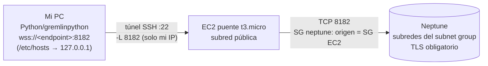
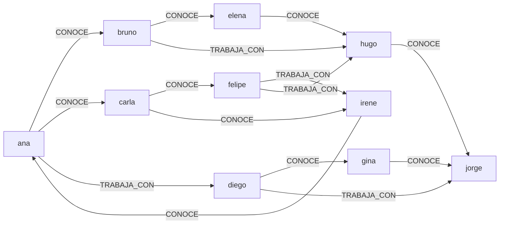

# Punto 4 – Amazon Neptune

## 1. Neptune vs Neo4j

| | Amazon Neptune | Neo4j |
|---|---|---|
| Modelo | Property graph **y** RDF (triple store) | Property graph (nativo) |
| Lenguajes | Gremlin, openCypher (property graph); SPARQL (RDF) | Cypher (y GQL), también soporta Gremlin vía plugin |
| Operación | Servicio gestionado en AWS, almacenamiento compartido autoescalable (hasta 128 TiB), réplicas de lectura | Autogestionado, Aura (gestionado) o Enterprise con clustering |
| Herramientas | Graph Explorer, notebooks (SageMaker/Workbench), integración IAM/CloudWatch/S3 bulk loader | Neo4j Browser, Bloom, Desktop, GDS (ciencia de datos de grafos), ecosistema maduro |
| Acceso | Solo dentro de VPC (o endpoint público opcional según versión) | Bolt/HTTP en cualquier host con red |
| Autenticación | IAM (SigV4) o sin auth dentro de la VPC | Usuario/contraseña propios, roles |

## 2. Despliegue de bajo costo: provisionada vs Serverless
Terraform en [terraform/](terraform): `mode = serverless` (`db.serverless`, 1–2,5 NCU) o `mode = provisioned` (`db.t4g.medium`, la clase más pequeña).

| (us-east-1, ref.) | Provisionada `db.t4g.medium` | Serverless |
|---|---|---|
| Cómputo | ~0,07 US$/h | ~0,16 US$/NCU-h × mínimo 1 NCU (≈0,16 US$/h; en versiones antiguas el mínimo era 2,5 NCU ≈ 0,40 US$/h) |
| Almacenamiento | ~0,10 US$/GB-mes | ~0,10 US$/GB-mes |
| I/O | ~0,20 US$/millón | ~0,20 US$/millón |

**Elección:** para una práctica corta y de baja carga, **`db.t4g.medium` provisionada suele ser la más barata por hora** (≈0,07 vs ≥0,16), mientras que Serverless conviene con cargas intermitentes/variables porque escala (y con mínimo de 1 NCU se acerca). *Verificar en la calculadora con la versión de motor usada y dejar captura.* **Desplegado realmente: `provisioned` con `db.t4g.medium`** (`-var mode=provisioned`; en `main.tf` el valor por defecto es `serverless`).

## 3. Consultar Neptune desde local

Neptune vive en la VPC y por defecto no tiene IP pública, así que el equipo local necesita un camino hacia la VPC.

| Opción | Cómo | Pros | Contras |
|---|---|---|---|
| **A. Túnel SSH vía EC2** (usada) | `ssh -N -L 8182:<endpoint>:8182 ec2-user@<EC2>` + entrada en `hosts` | Simple, estándar, sirve para Gremlin y openCypher | EC2 extra (~0,017 US$/h), puerto 22 abierto a mi IP |
| **B. Session Manager (SSM) port forwarding** | `aws ssm start-session --target <i-…> --document-name AWS-StartPortForwardingSessionToRemoteHost --parameters host=<endpoint>,portNumber=8182,localPortNumber=8182` | Sin puerto 22 ni llaves SSH (usa IAM) | Sigue requiriendo una EC2 con rol SSM |
| **C. Endpoint público de Neptune** | Requiere motor **≥ 1.4.6**, **IAM auth obligatoria**, subredes públicas (ruta a Internet Gateway) en el subnet group, SG con TCP 8182 desde mi IP y marcar `--publicly-accessible` en **cada instancia**; se firma cada solicitud con SigV4 | Sin EC2 ni túnel | Mayor superficie de ataque (el endpoint resuelve a IP pública), hay que firmar con SigV4 (más código) y exponer subredes públicas; no se probó en este taller por riesgo/beneficio |
| **D. Sin EC2 propia en el flujo** | Neptune *Graph Explorer* / notebook de Neptune Workbench (SageMaker) dentro de la VPC; AWS CloudShell con entorno VPC; Lambda en la VPC; VPN/Direct Connect | No hay que administrar un bastión | Cada uno tiene su propio costo/limitación (notebook = instancia SageMaker) |

**Arquitectura de acceso (opción A, la usada):**



**¿Es necesario el proceso con EC2? No necesariamente:** es la forma más sencilla y barata si no hay otra conectividad, pero existen alternativas (B, C y D).

**Documentación de la opción elegida (A):**
- **VPC:** VPC por defecto; Neptune en el *DB subnet group* (≥2 AZ) y la EC2 en una subred pública (IP pública para recibir SSH).
- **Rutas:** la tabla de rutas de la VPC por defecto ya enruta el tráfico local entre subredes (`local`); la subred pública tiene ruta `0.0.0.0/0 → Internet Gateway` solo para que la EC2 reciba SSH.
- **Security groups:** `taller-neptune-bastion`: TCP 22 desde *mi IP/32*. `taller-neptune`: TCP **8182** con origen = SG de la EC2.
- **Autenticación:** en el laboratorio `iam_database_authentication_enabled = false` (el acceso está limitado por red). Para habilitar IAM: `true` y firmar cada solicitud con SigV4 (`botocore.auth.SigV4Auth`, servicio `neptune-db`, con permisos `neptune-db:*`); en producción debe estar activado.
- **TLS:** Neptune exige `wss://`; por eso el truco de `hosts` para que el nombre del endpoint coincida con el certificado.

## 4. Grafo: modelo

10 vértices `persona {nombre, ciudad, edad}` y 15 aristas `CONOCE` / `TRABAJA_CON` `{desde}`.



Consultas en [python/neptune_graph.py](python/neptune_graph.py) (todas recorren relaciones):
1. **Amigos de amigos de Ana** (2 saltos `CONOCE`, excluyendo conocidos directos).
2. **Camino más corto Ana → Jorge** (`repeat/until` con `simplePath`).
3. **Top 3 más conectados** (grado total con `bothE().count()`).
4. Extra: quién `TRABAJA_CON` alguien que vive en Cali.

**Resultados reales** (captura [01_neptune_graph_resultados.png](evidencias/01_neptune_graph_resultados.png)):

| Consulta | Resultado | Interpretación |
|---|---|---|
| Conteo | **Vértices 10 / Aristas 15** | El grafo cumple el mínimo pedido (10 y 15) |
| 1. Amigos de amigos de Ana | Irene, Felipe, Elena | Personas a 2 saltos que Ana no conoce directamente |
| 2. Camino más corto Ana → Jorge | Ana → Diego → Jorge (2 saltos) | Ana llega a Jorge a través de Diego |
| 3. Top 3 más conectados (grado) | Ana 4, Hugo 4, Carla 3 | Carla empata con otros en 3 conexiones; el orden entre empates es arbitrario |
| 4. (extra) Trabaja con alguien de Cali | Diego, Ana | |

*Nota técnica:* con `gremlinpython` ≥ 3.7 `.iterate()` envía el paso `discard`, no soportado por Neptune (`Unable to find Traversal steps for the graph operator: discard`); se usa `.toList()`. Para excluir conocidos directos se usa `P.without(...)` (no `__.not_(__.within(...))`).

## 5. Ejecución
```bash
ssh-keygen -t ed25519 -f ~/.ssh/taller-neptune -N ""
cd terraform
terraform init && terraform apply -var "my_ip_cidr=$(curl -s ifconfig.me)/32" -var mode=provisioned
EP=$(terraform output -raw neptune_endpoint); IP=$(terraform output -raw bastion_public_ip)
echo "127.0.0.1 $EP" | sudo tee -a /etc/hosts
ssh -i ~/.ssh/taller-neptune -N -L 8182:$EP:8182 ec2-user@$IP &     # túnel
cd ../python && NEPTUNE_ENDPOINT=$EP python neptune_graph.py
# al terminar:
kill %1; cd ../terraform && terraform destroy -var "my_ip_cidr=0.0.0.0/32"
# quitar la línea del endpoint de /etc/hosts
```
Neptune no usa contraseña de base de datos (autentica por red/IAM), por lo que **no requiere secreto en Secrets Manager**.

## 6. Preguntas de costos
- **Cómputo y almacenamiento:** ver tabla del apartado 2 (≈0,07 US$/h provisionada; ≥0,16 US$/h Serverless) + ~0,10 US$/GB-mes de almacenamiento (mínimo facturado ~10 GB) + I/O.
- **¿El método de conexión añade una EC2?** Sí en la opción A (≈0,017 US$/h entre instancia, IPv4 y disco). Las opciones C y D la evitan (D puede añadir un notebook).
- **¿Qué se cobra aunque no haya consultas?** La instancia de Neptune encendida (la provisionada cobra 24/7; Serverless mantiene el mínimo de NCU), el almacenamiento, los backups, la EC2 y su IP pública. Neptune puede *detenerse* hasta 7 días, pero el almacenamiento sigue cobrándose; para el taller se **elimina** todo.
- **Estimación ~3 h (provisionada):** 0,21 + EC2 0,05 + almacenamiento ≈ 0,01 → **≈ US$0,3**.
- **Costo real:** el clúster estuvo encendido ~2 días por no destruirlo a tiempo: 48 h × (≈0,07 + ≈0,017) ≈ **US$3–4**. Lección: destruir apenas se tenga la evidencia.
- Precios de Neptune (db.t4g.medium ≈ 0,07 US$/h, NCU ≈ 0,16 US$/h) son referencia sin verificar en esta sesión: confirmar en la calculadora.

## 7. Evidencias ([evidencias](evidencias))
- [01_neptune_graph_resultados.png](evidencias/01_neptune_graph_resultados.png): conteos y consultas en Python contra Neptune.
- La eliminación del clúster y la verificación (sin clusters RDS/Neptune ni EC2) están en [../evidencias/verificacion_global_final.png](../evidencias/verificacion_global_final.png).
